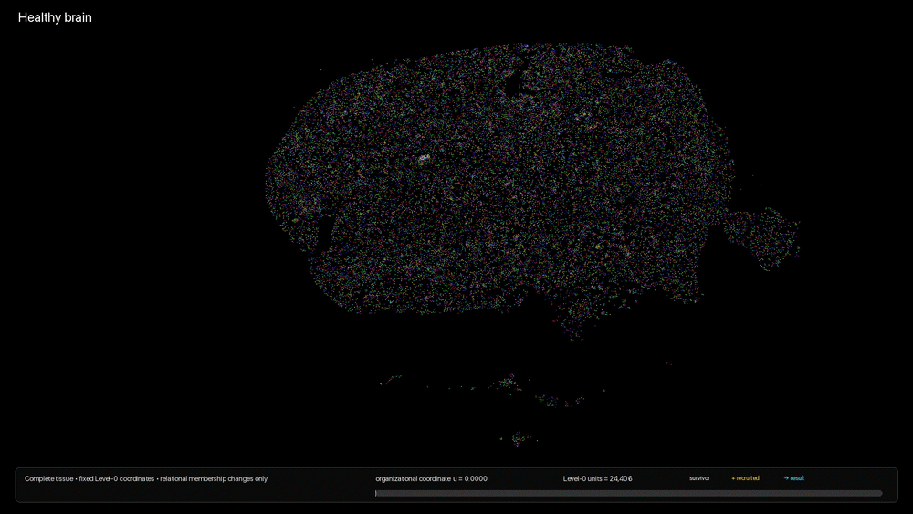

# SUTRA

### Spatial Unified Transcriptomic Reconstruction and Analysis

**Reconstructing how molecular and spatial organization are threaded through tissue architecture across scales.**

<p align="center">
  
</p>

SUTRA (सूत्र, *sūtra*: a thread) is a computational framework for studying tissue architecture from spatial transcriptomic observations. It connects molecular measurements, local cellular neighborhoods, tissue geometry, and higher-order organizational relationships within a recursive, specimen-aware hierarchy. Rather than treating a tissue as a single embedding or a collection of disconnected scales, SUTRA follows how observable relationships persist, change, and reorganize as the representation of tissue structure evolves.

The associated study examines healthy and disease-associated tissue organization, including brain and kidney specimens. The framework is designed to make organizational trajectories, their molecular associations, and their spatial localization inspectable, with numerical provenance retained alongside publication figures.

## What SUTRA provides

- **Spatially grounded tissue reconstruction.** Begin with measured molecular and geometric context and build an interpretable hierarchy of tissue organization.
- **Relationships across organizational scale.** Track tissue structure and molecular associations as organizational levels evolve, retaining spatial and specimen context.
- **Disease-associated comparisons.** Quantify and visualize relational displacement and localized differences between reference and disease-associated tissues, subject to the comparisons supported by the released datasets.
- **Predictive analysis.** Evaluate how initial spatial and relational features inform later states along the *reconstructed hierarchy*, using held-out prediction outputs. Hierarchy progression is **not** biological time.
- **Auditable publication products.** Provide standalone figure panels, canonical rendering scripts, frozen numerical source data, and supplementary movie provenance.

SUTRA analyzes an open biological system; its organizational signatures should not be read as evidence of an equilibrium critical point or a biological time course.

## Start here

| Goal | Location |
| --- | --- |
| Run the production workflow | [`part1_production/`](part1_production/) |
| Inspect publication panels | [`part2_paper/main/`](part2_paper/main/) |
| Inspect supplementary figures and movies | [`part2_paper/supplementary/`](part2_paper/supplementary/) |
| Inspect canonical figure scripts | [`part2_paper/code/canonical_panels/`](part2_paper/code/canonical_panels/) |
| Download Supplementary Movies 6–15 | [Supplementary video release](https://github.com/umdsid/SUTRA/releases/tag/supplementary-videos-v1) |

### Production workflow

The public entry point is `part1_production/run_sutra.sh`:

```bash
git clone https://github.com/umdsid/SUTRA.git
cd SUTRA/part1_production
./run_sutra.sh --help
./run_sutra.sh --preflight
./run_sutra.sh --run
```

The five-specimen workflow is sequential. Historical stage numbers in internal runner filenames preserve provenance; they are not separate public SUTRA versions. **Raw spatial transcriptomic data and large resources are not bundled with the repository.** Supply the required inputs under the documented `data/` and `resources/` locations before running production. A successful preflight does not itself establish a complete scientific reproduction.

### Paper figures and source data

`part2_paper/` contains approved, frozen scientific products and canonical standalone panel-generation code. Main figures are distributed as individual panel files rather than a single flattened composite. Preserve the supplied numerical source tables and original panel exports when preparing derivatives.

| Product | Where to look |
| --- | --- |
| Main Figures 1–6 | `part2_paper/main/fig1/` … `fig6/` |
| Supplementary Figures 1–8 | `part2_paper/supplementary/` |
| Canonical rendering code | `part2_paper/code/canonical_panels/` |
| Supplementary Movies 1–5 | `part2_paper/supplementary/movies/movie1/` … `movie5/` |
| Supplementary Movies 6–15 | [GitHub release assets](https://github.com/umdsid/SUTRA/releases/tag/supplementary-videos-v1) |
| Movie 6–15 metadata/provenance | `part2_paper/supplementary/movies/molecular/` |

Movies 6–15 are hosted as release assets rather than duplicated as large binary files in the Git tree. The release includes numbering and provenance materials. Refer to its manifest and checksums when retrieving the videos. The availability of a movie does not, by itself, certify that its complete generation pipeline has been rerun.

## Reproducibility: what has been checked

The repository distinguishes **inventory and frozen-source verification**, **rendering from frozen numerical inputs**, and **end-to-end scientific recomputation**. These are different levels of evidence and should not be conflated.

In the Figure 5–6 audit, all 11 standalone panels were rendered from frozen sources; eight regenerated numerical CSV tables matched the corresponding frozen tables. Both Figure 6 out-of-fold prediction datasets (236,501 observations combined) were decoded through an independent Parquet reader and compared with their original decoded values, with zero mismatched rows under the comparison performed. Figure 5C was an exact frozen-file copy; the other ten regenerated PNGs were not byte-identical to the approved exports and underwent separate visual review. The Figure 5D nonfinite audit remains a frozen artifact not regenerated by that renderer. **These checks do not constitute a fresh end-to-end rerun of the scientific analysis or model fitting.**

Other figures and movies have their own provenance and verification status. Consult the repository's audit records and source files for the applicable level of support rather than assuming a single global reproduction status.

## Scientific interpretation

The organizational coordinate indexes a reconstructed hierarchy, not elapsed experimental or biological time. Cross-specimen comparisons must respect tissue-specific biology and available reference context. SUTRA reports empirically supported multiscale signatures in living, open nonequilibrium tissue systems without asserting an equilibrium phase transition.

## Software and attribution

The public Python namespace is `sutra`. Historical `strata` and `strata_hierarchy` namespaces are not public interfaces of this release.

**Authors:** Siddharth Sharma and Sanjay Jain.

Please cite the associated SUTRA manuscript when using the methods or publication results. The manuscript citation and persistent identifier should be added here when publicly available. Consult the repository's license file for applicable reuse terms; no license is implied by this README.

## Project status

This repository is a research software and publication-source release. Some datasets, intermediate outputs, and large movie assets are distributed separately. Scientific reproduction claims are scoped to the checks actually performed and documented.
